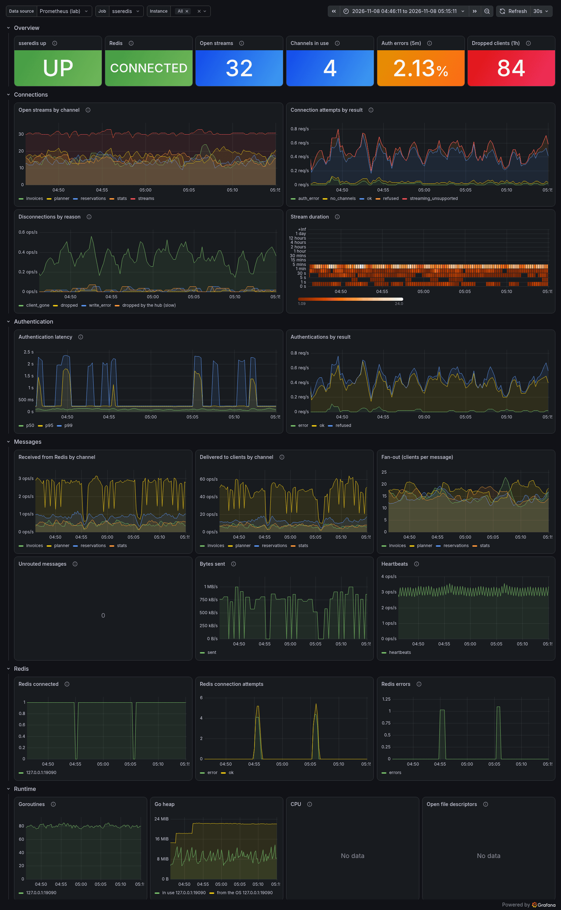

# sseredis

Proxies Redis channels as HTTP SSE endpoints (thus read only).

It's also provide a broker to authenticate against active django sessions.

## Running

```sh
go build && ./sseredis -redis redis:6379 -listen :80 -dmbcau http://dmbcau/authenticator/
```

| Flag | Default | Meaning |
|------|---------|---------|
| `-redis` | `redis:6379` | Redis server address: `host:port`, or `unix:/path/to/redis.sock`. |
| `-listen` | `:80` | Address to bind: `host:port`, or `unix:/path/to/sock` (see [unix sockets](#running-with-unix-sockets-systemd)). |
| `-listen-mode` | `0660` | Permissions (octal) of the `-listen` unix socket. Ignored for TCP. |
| `-dmbcau` | `http://dmbcau/authenticator/` | Django authenticator API (see [Authentication](#authentication)). |
| `-dmbcau-socket` | (empty) | Unix socket to reach the authenticator API through. The `-dmbcau` URL still gives the scheme, `Host` header and path. Empty: connect to the URL's host. |
| `-auth-timeout` | `5s` | Timeout of a call to the authenticator API. |
| `-origin` | (empty) | Origin allowed to open the stream cross-origin, with its cookies (e.g. `https://app.example.org`). Empty: same-origin only. `*` allows any origin but without cookies, so only without authentication. |
| `-metrics` | (empty) | Address to serve [Prometheus metrics](#monitoring) on, at `/metrics`: `host:port`, or `unix:/path/to/sock`. Empty: no metrics. Never the `-listen` address. |
| `-metrics-mode` | `0660` | Permissions (octal) of the `-metrics` unix socket. Ignored for TCP. |
| `-log` | `INFO` | `DEBUG`, `INFO`, `WARNING`, `ERROR` or `FATAL`. |

### Running with unix sockets (systemd)

On a single host every connection can go through unix sockets instead of TCP:

```sh
sseredis -listen unix:/run/sseredis/sseredis.sock -listen-mode 0666 \
  -redis unix:/run/redis/redis-server.sock \
  -dmbcau http://dmbcau/authenticator/ -dmbcau-socket /run/dmbcau-auth/nginx.sock
```

- `-listen unix:...`: at start sseredis removes a socket file left at that path by a run that did not shut
  down cleanly (only if it is a socket: any other file makes it fail), listens, then sets the socket's
  permissions to `-listen-mode`. On `SIGTERM`/`SIGINT` (`systemctl stop`) it closes the open streams and
  removes the socket.
- `-dmbcau-socket`: every call to the authenticator connects to that socket; here `dmbcau` is only the
  `Host` header nginx (or Django) sees, it is never resolved.
- `-listen-mode 0666` does not mean anyone can connect: connecting needs search permission on every
  directory of the path too. With `/run/sseredis` owned by `sseredis:www-data` with mode `0750`, only
  sseredis and the `www-data` group (nginx) can reach the socket. With systemd:

  ```ini
  [Service]
  User=sseredis
  Group=www-data
  RuntimeDirectory=sseredis
  RuntimeDirectoryMode=0750
  ```

  (sseredis' user must also be allowed to connect to Redis' and dmbcau's sockets, e.g. be in the `redis`
  group.)

On the nginx side:

```nginx
upstream sse {
    server unix:/run/sseredis/sseredis.sock;
}
```

and `proxy_pass http://sse/;` in the [location](#nginx). There is no client IP on a unix socket: sseredis
takes it from `X-Forwarded-For` (see [Client IP](#client-ip)), so nginx must set it.

Tests: `go test -race ./...` (Redis is simulated with miniredis, nothing to install).

## Design

A client opens `GET /?subscribe=chan1,chan2`. After [authentication](#authentication) it receives, as SSE
`data:` events, the messages published on those Redis channels, plus a `:heartbeat` comment every 10s.

- One goroutine (the `Hub`, `hub.go`) owns the clients and the Redis subscriptions; it subscribes to a channel
  when its first client arrives and unsubscribes when the last one leaves.
- It never waits for a client: each client has a queue of 64 messages, and a client whose queue is full
  (stalled or gone) is dropped. Its browser `EventSource` reconnects by itself.
- Each write to a client must finish within 30s. A connection is closed if it takes more than 10s to send
  its request headers, or waits more than 120s for its next request (longer than nginx's default upstream
  `keepalive_timeout` of 60s, so nginx closes first). Open streams are not affected.
- If the Redis connection fails, `redisLoop` (`redis.go`) reconnects with exponential backoff (1s, 2s, ... up
  to 30s) and subscribes again to all the channels in use. Messages published meanwhile are lost.

## Authentication

Authentication goes through the `Authenticator` interface (`auth.go`), so another backend can replace Django.
`DjangoAuth` reads the `sessionid` cookie and calls the authenticator API with the requested channels, one
`channel` parameter each (`request.GET.getlist("channel")` in Django):

```
GET <-dmbcau>?sessionid=<cookie>&clientip=<client IP>&channel=<chan1>&channel=<chan2>
```

Django must answer `200` only if the session is valid **and** may read every listed channel, `403` otherwise:
sseredis subscribes to whatever channel the client asks for, so this check is the only thing keeping a
user from reading another user's channels.

`200` accepts the client. A `4xx` refuses it with the same status; anything else (including redirects, which
are not followed, and timeouts) refuses it with `502`/`500`.

## nginx

A location proxying to sseredis (the path is an example):

```nginx
location /sse/ {
    proxy_pass http://sseredis:80/;
    proxy_http_version 1.1;
    proxy_set_header Connection "";
    proxy_set_header X-Forwarded-For $remote_addr;   # on the public-facing nginx, see "Client IP"
    proxy_buffering off;      # sseredis also sends "X-Accel-Buffering: no"
    proxy_read_timeout 60s;   # the default; heartbeats every 10s keep the stream alive
}
```

## Monitoring

With `-metrics` sseredis serves [Prometheus](https://prometheus.io/) metrics at `/metrics` on a listener of its
own, so they are never reachable through the public `-listen` address. The repository also has:

- `grafana/sseredis.json`: a Grafana dashboard (Dashboards > New > Import, then pick the Prometheus data
  source). Its `job` and `instance` variables select the targets.
- `grafana/alerts.yaml`: Grafana alert rules (file provisioning: `/etc/grafana/provisioning/alerting/`). Set
  the uid of your Prometheus data source (`__PROMETHEUS_UID__`) and, if your scrape job isn't called
  `sseredis`, its name; the commands are at the top of the file.



The dashboard over 30 minutes of simulated traffic: about 30 clients on 4 channels, a stalled client now and
then (dropped by the hub), a fake Django refusing 13% of the sessions and failing 2%, and Redis restarting
every 10 minutes (down for 20s). CPU and file descriptors are empty because it ran on FreeBSD (see below).
The full workload is in [`grafana/README.md`](grafana/README.md).

### Metrics

| Metric | Type | Meaning |
|--------|------|---------|
| `sseredis_clients_connected` | gauge | SSE streams open now. |
| `sseredis_channel_clients{channel}` | gauge | Streams open now, by channel (a stream counts in each of its channels). |
| `sseredis_connections_total{result}` | counter | Connection attempts: `ok`, `no_channels`, `refused` (the authenticator answered 4xx, e.g. an expired session), `auth_error` (it is down, timed out or answered 5xx), `streaming_unsupported`. |
| `sseredis_disconnections_total{reason}` | counter | Streams closed, by how the handler noticed: `client_gone` (client or server hung up), `write_error` (includes the 30s write timeout), `dropped` (the hub had already dropped it). |
| `sseredis_clients_dropped_total` | counter | Clients the hub dropped because their queue was full. The handler of such a client is usually stuck in a write, so it mostly shows up as a `write_error` disconnection 30s later: use this counter for drops. |
| `sseredis_connection_duration_seconds` | histogram | How long streams stayed open (observed when they close). |
| `sseredis_auth_duration_seconds{result}` | histogram | Time to authenticate a connection: `ok`, `refused`, `error`. |
| `sseredis_redis_connected` | gauge | 1 while connected to Redis. |
| `sseredis_redis_connects_total{result}` | counter | Attempts to connect to Redis: `ok`, `error`. |
| `sseredis_redis_errors_total` | counter | Errors on the Redis connection (including the ones that close it) and failed (un)subscribes. |
| `sseredis_redis_channels_subscribed` | gauge | Redis channels at least one client listens to. |
| `sseredis_redis_messages_received_total{channel}` | counter | Messages received from Redis. |
| `sseredis_messages_sent_total{channel}` | counter | Messages queued to clients, one per client. |
| `sseredis_messages_unrouted_total{channel}` | counter | Messages no client was subscribed to. A few are normal (the last client left meanwhile). |
| `sseredis_heartbeats_sent_total` | counter | Heartbeats queued to clients, one per client. |
| `sseredis_bytes_sent_total` | counter | Bytes written to the streams (body only, heartbeats included). |

Plus the Go runtime (`go_*`, including `go_build_info`) and, on Linux, macOS and Windows only, the process
metrics (`process_*`: CPU, memory, file descriptors). `client_golang` has no process collector for FreeBSD.

The `channel` label takes only channels Django authorized, assumed to be a handful of names: if channels ever
become per object (`reservation-1234`), drop the label, or the number of series grows without bound. The client
IP is never a label (personal data, unbounded).

### Scraping through nginx

When Prometheus runs on another server it scrapes through the public nginx, which lets only the Prometheus
server in:

```nginx
# sseredis -metrics 127.0.0.1:9090 (or unix:/run/sseredis/metrics.sock)
location = /sseredis/metrics {
    allow 203.0.113.10;   # the Prometheus server
    deny all;
    proxy_pass http://127.0.0.1:9090/metrics;   # or http://unix:/run/sseredis/metrics.sock:/metrics
}
```

- Put it in the HTTPS server: the allow rule says who may connect, TLS keeps the metrics (channel names,
  traffic) private on the way.
- `allow` checks `$remote_addr`. If nginx takes it from a header with `set_real_ip_from`/`real_ip_header`
  (see [Client IP](#client-ip)), anyone the balancer lets through can claim the Prometheus address, unless
  `set_real_ip_from` lists only the balancer.
- Bind `-metrics` to `127.0.0.1` or a unix socket, so the only way in is this location.

On the Prometheus side:

```yaml
scrape_configs:
  - job_name: sseredis   # the alert rules expect this name (or change it in them)
    scheme: https
    metrics_path: /sseredis/metrics
    static_configs:
      - targets: ["dmbcau.example.org"]
```

## Client IP

The client IP is logged and sent to Django (`clientip`). In production both Django and sseredis are behind
nginx, so the TCP peer is nginx and the client IP comes from `X-Forwarded-For`.

`X-Forwarded-For` is the de-facto standard for this, and it works with several proxies: each proxy appends
the address it got the connection from, so the header reads `client, proxy1, proxy2`. The catch is that the
client can send the header too, and a proxy that appends keeps what the client wrote as the first entry. Only
the entries written by our own proxies can be trusted.

The rule (`clientIP` in `ip.go`):

- The **public-facing nginx overwrites** `X-Forwarded-For` with the address it sees, dropping whatever the
  client sent. Proxies after it (if any) append. So the header holds only addresses written by our
  proxies, and its **first entry is the client**.
- sseredis takes the first entry. Without the header (or if it is not an IP) it uses the address of the peer
  that connected to it, or `unix` if that peer came through a unix socket.
- Django must compute the client IP the same way, or the IP sseredis sends will not match the session's.

What nginx must do:

1. On the public-facing nginx, for **both** the sseredis and the Django locations:

   ```nginx
   proxy_set_header X-Forwarded-For $remote_addr;   # overwrite, never $proxy_add_x_forwarded_for
   ```

2. On any proxy between it and sseredis/Django: append.

   ```nginx
   proxy_set_header X-Forwarded-For $proxy_add_x_forwarded_for;
   ```

3. If a load balancer or CDN sits in front of the public nginx, `$remote_addr` is the balancer. Make nginx
   take the client from the balancer's header first ([realip module](https://nginx.org/en/docs/http/ngx_http_realip_module.html)),
   trusting only the balancer's addresses, then keep rule 1:

   ```nginx
   set_real_ip_from 10.0.0.0/8;          # the balancer's addresses only
   real_ip_header   X-Forwarded-For;
   real_ip_recursive on;
   ```

4. sseredis (and Django) must be reachable **only through nginx** (bind to the internal network, firewall
   it, or use a unix socket only nginx can open). Anyone who can connect directly can send any `X-Forwarded-For`.
